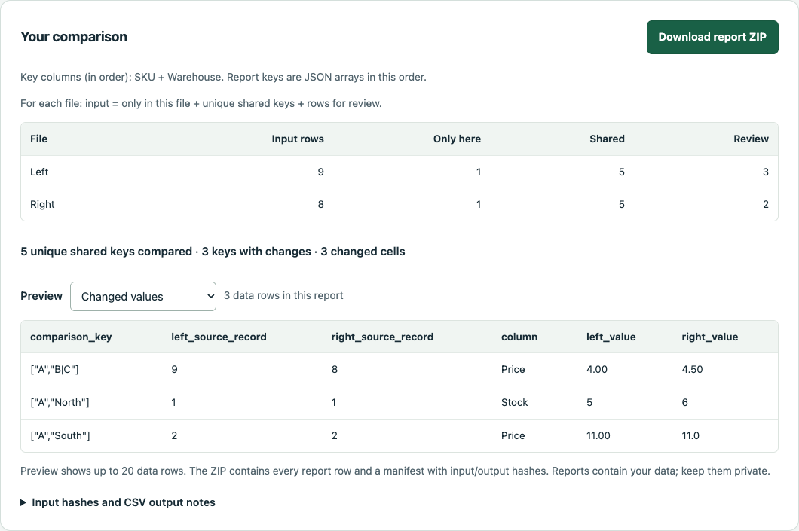

# Local Row Check

Version 1.3.0 adds multi-column keys to the Python CLI and single-file offline
browser edition. Match on a combination such as SKU + Warehouse, while keeping
blank components and duplicated combinations in review.

[Open the free browser edition](https://jhrch7.github.io/local-row-check/) or
download the standalone file below. GitHub serves the online page and logs page
visits; chosen CSV files are processed locally by the comparison code.

Compare two CSV exports on your computer. Find keys that appear in only one file,
review blank or duplicate keys separately, and optionally compare selected values
on unique shared keys. Nothing is uploaded. No account,
AI service or third-party Python package is needed to run it.

**Without Python:** [download the offline HTML file](https://github.com/jhrch7/local-row-check/releases/download/v1.3.0/rowcheck-offline.html),
save it, and open it locally in a current Chromium browser. Choose the two files,
key columns and optional value columns, then download the report ZIP.
[Browser guide and verified limits](browser/README.md). This edition uses exact
keys and UTF-8 inputs, up to 2 MiB and 50,000 data records per file.

Select **Try multi-column keys** to load the synthetic warehouse example. It
matches five unique SKU + Warehouse combinations, holds five ambiguous rows
across the two inputs for review, and finds three changed cells:



The source, guide, examples and tests are free under the MIT licence.
Download the [1.3.0 source ZIP](https://github.com/jhrch7/local-row-check/archive/refs/tags/v1.3.0.zip)
or clone this repository.

For a small comparison handled for you, the optional
[CSV-comparison pilot](https://github.com/jhrch7/csv-comparison-pilot) has an
indicative A$40 total price. It covers two non-sensitive CSVs within its stated
limits. Scope, availability, delivery, turnaround and payment are agreed before
any order. Running the tool yourself is free.

## Start with the Python CLI

Requires Python 3.9 or later and two CSV files with common key headers.
The current sixteen CLI checks passed on macOS with Python 3.14.6. Nine
single-key cases produced the same CSV bytes and manifest fields, except the
version, as the previous 1.1.0 engine. The earlier eleven single-key checks also
passed on GitHub-hosted Ubuntu 24.04 and Windows Server 2025 with Python 3.14.9
([previous verification run](https://github.com/jhrch7/local-row-check/actions/runs/41469427847)).
The new multi-column feature has not been exercised on those operating systems
or other Python versions.

1. Unzip the source download, or clone the repository.
2. Open a terminal in the unzipped folder.
3. Run the included example:

```sh
python3 rowcheck.py examples/left.csv examples/right.csv --key "Contact Name" --out example-report
```

On Windows, use `py -3` in place of `python3` if that is your Python command.
The command prints counts and creates `example-report`. Open `manifest.json` to
check the counts and `review.csv` for rows requiring a decision.

To compare your own exports:

```sh
python3 rowcheck.py "first export.csv" "second export.csv" --key "Customer ID" --out "new report"
```

Use a unique, stable identifier when available. A shared name alone does not prove
that two rows describe the same person. This tool compares strings and makes no
identity judgement. The default run compares keys only; value comparison is an
explicit option below.

## Match on several columns

When a SKU repeats at different warehouses, use the combination rather than
guessing which rows belong together. Repeat `--key` for each exact header:

```sh
python3 rowcheck.py examples/warehouse/left.csv examples/warehouse/right.csv --key SKU --key Warehouse --compare-columns Price Stock --out warehouse-report
```

In the browser, choose the first key, select **Add key column**, and choose the
next header. Each component must match. Every selected key column must be
present in both files and can be chosen only once. A column serving as a key
cannot also be selected for value comparison. No key is guessed for your files.

The warehouse example has nine left records and eight right records. Five key
combinations are unique and shared; one appears only on each side. Three left
records and two right records go to review. Three selected cells differ.
See the [inputs and generated CLI reports](examples/warehouse).

Components stay separate: `A|B` + `C` differs from `A` + `B|C`. If **any**
component is blank or whitespace-only, the row goes to review. If a complete
combination is duplicated in either input, all its rows on **both** sides go to
review, including a lone row in the other file. Repetition in just one component
does not make the full combination ambiguous.

Multi-column report keys use compact JSON arrays in the chosen column order,
for example `["A","North"]`. `manifest.json` records `key_columns` and the
encoding. `shared_keys.csv` also keeps the original components in JSON arrays.
The CLI's explicit `trim` or `fold` rule applies separately to each component;
the browser uses exact text only. Single-column runs keep the existing scalar
key format. Headers containing commas or spaces are one header: quote them;
do not join column names with commas.

## The four default reports

| File | Meaning |
|---|---|
| `only_left.csv` | Rows whose unique key occurs only in the first input |
| `only_right.csv` | Rows whose unique key occurs only in the second input |
| `review.csv` | All rows with a blank key or a key duplicated in either input |
| `shared_keys.csv` | Keys occurring exactly once in each input, with source record numbers |

`manifest.json` records source hashes, column names, output hashes and row counts.
For each side: **input = only + shared + review**. A source record number starts
at 1 after the header and counts CSV records, not physical lines. A quoted field
may contain a newline without becoming two records.

Every row in a duplicated-key group goes to review, including the corresponding
row from the other file. Duplicate rows are not silently discarded or counted as
a resolved match. The review file retains original row values inside a JSON cell.

## Compare selected values

For catalogue-style exports, choose the non-key columns you want checked:

```sh
python3 rowcheck.py examples/catalog/left.csv examples/catalog/right.csv --key SKU --compare-columns Price Stock --out catalog-report
```

This adds `value_changes.csv`: one row per changed cell, with the comparison key,
column, before/after values and both source-record numbers. The manifest and
terminal summary also count the shared keys checked, keys with changes, keys
without selected changes and changed cells. All five CSVs have output hashes.

The example has three unique shared keys, two with changes across three selected
cells. One price changes from `20.00` to `20.0`: these are different strings even
though a numeric interpretation might consider them equal. A changed title is
ignored because `Title` was not selected. See the [actual example reports](examples/catalog/report).

Column names must be unique, non-key headers present in both files; quote names
containing spaces. Values are compared as exact decoded strings. Key trimming or
case-folding does not change value comparison. No numeric, date or currency
coercion is performed. Blank or duplicated keys still go entirely to review and
are never paired for cell comparison. A key with no selected changes does not
mean the complete rows agree. Formula-like output cells receive the same
spreadsheet apostrophe prefix described below; use source records for originals.

Without `--compare-columns`, the four-report key comparison remains the default.

## Choose comparison rules deliberately

The default is exact, case-sensitive text. `Alex`, `alex` and `Alex ` differ.
Only choose a broader rule if it is right for your data:

```sh
python3 rowcheck.py left.csv right.csv --key "Contact Name" --normalise trim --out trimmed-report
python3 rowcheck.py left.csv right.csv --key "Contact Name" --normalise fold --out folded-report
```

- `none`: exact text; the default.
- `trim`: remove leading and trailing whitespace.
- `fold`: Unicode NFKC normalization, collapse whitespace and case-fold. This can
  make different original strings equal; inspect the shared-key report.

Whitespace-only keys always require review. There is no fuzzy matching,
accent stripping, enrichment or automatic correction.

## File formats and privacy

Export Excel or Google Sheets files as CSV first. `.xlsx` workbooks, PDFs and
Google account connections are not supported. The two files can have different
non-key columns. Headers must be nonempty and unique. Malformed-width records,
NUL characters, undecodable text and fields over 10 MiB are rejected. The files
are read into memory, so keep exports small enough for your computer.

The default input is comma-separated UTF-8, with an optional BOM. For
semicolon-separated exports add `--delimiter ';'`. If necessary, choose the actual
input encoding, for example `--encoding cp1252`. Encoding selection does not
repair a damaged export. Output CSVs are UTF-8 with BOM.

Original files are opened only for reading. Reports contain your data too:
keep the report directory private. The tool has no network code or telemetry.

Formula-like cells in generated CSVs are prefixed with an apostrophe to reduce
spreadsheet formula execution risk. This deliberately changes their CSV text
representation. The manifest counts those cells. Use your unchanged input files
as the authority for original values. Re-saving or stripping the prefix in a
spreadsheet can remove that protection.

## Troubleshooting

The output directory must be new. Choose another name for each run; existing
reports are never overwritten. The output directory's parent must exist.

An error returns exit code 2 and a reason on standard error. Invalid inputs fail
before the output directory is created. A disk/write failure can leave a partial
directory, including an incomplete manifest if its final write fails. Require a
successful exit, a complete parseable `manifest.json`, and output bytes matching
its recorded sizes and hashes. Do not use partial output.

To run the included verification:

```sh
python3 -B -m unittest discover -s . -p 'test_*.py' -v
```

## Licence and provenance

The code and guide are offered under the included MIT licence, which permits
modification and redistribution, including commercial use. There is no exclusive
licence or restriction preventing others from sharing the code. The download
contains the runnable script, guide, synthetic examples and tests.

The original 1.0.0 public source remains available at its
[pinned commit](https://github.com/jhrch7/local-row-check/tree/218b27bd270bc32b737f144343f61488e1e3e891).

This release was produced with AI coding assistance and checked by automated CLI
tests and an example run. No customer adoption, independently audited security,
data-cleaning accuracy beyond its declared comparison rules, or earnings are
claimed. Keep originals and check the review file before making business changes.

## Voluntary support enquiries

If this free tool is useful to you, you can [offer voluntary support by email](mailto:jayos00001@gmail.com?subject=Local%20Row%20Check%20voluntary%20support).
Any amount, currency and receiving method must be agreed before funds are sent; please do not send account details or credentials.
This is optional support for further public work, with no promised features, service, response time or charitable tax deduction. The existing licence stays the same.

## Measured CLI baseline

A pinned macOS arm64 run compared two synthetic 100,000-record CSVs in 1.197 seconds
with 262.7 MiB peak resident memory. See the [source, fixture recipe and limits](benchmarks/cli-memory-2026-11-03.md)
for both measured sizes and verified output counts/hashes. These are specific
observations, not a general capacity or timing guarantee; browser limits are unchanged.
